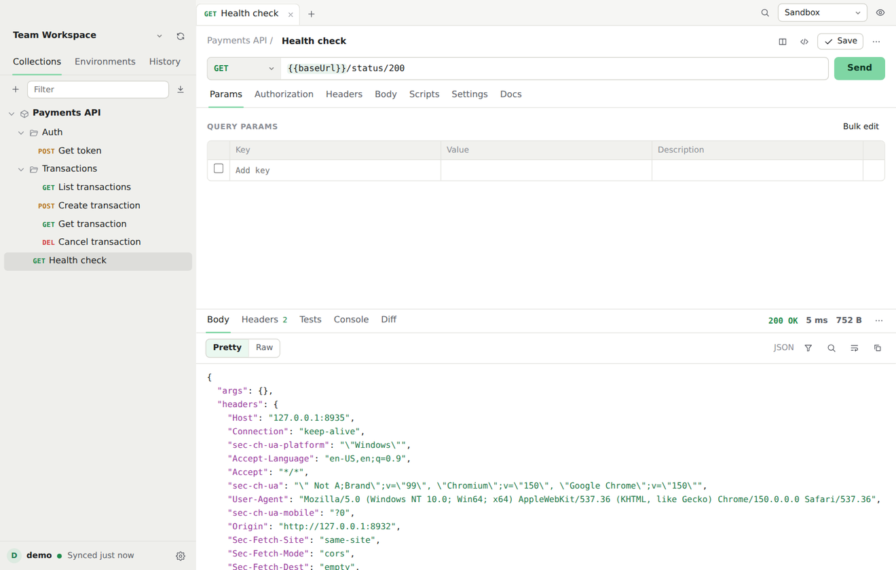
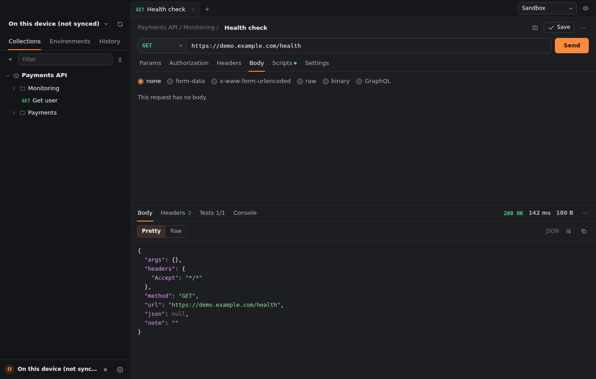
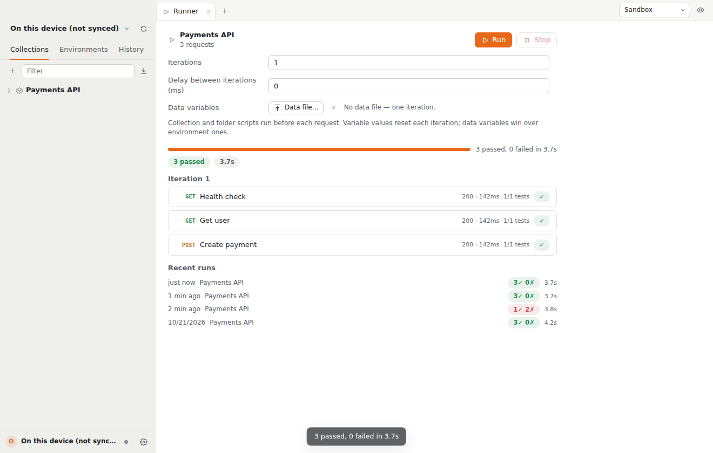

# Dispatch

<p align="center">
  
  <br><sub>Dispatch in light and dark, with the collection runner.</sub><br>
  
  
</p>

A lightweight API client that works with your existing Postman account. It reads and writes your workspaces, collections, environments and globals through Postman's official API, so your team can keep using Postman while you use something much lighter — and it runs entirely on this device without a Postman account too.

Native on **macOS 13+** (Apple Silicon and Intel), **Windows** (10/11) and **Linux** (glibc `x86_64`).

## What it does

- **Profiles.** A built-in local profile keeps requests, collections and environments on this device only; any Postman account can be added as a profile with its own key, region and workspace memory. Switch from the footer in one click.
- **WebSocket.** Requests whose URL starts with `ws://`/`wss://` open a live connection instead of a one-shot send: frames stream in (with sizes), you compose and send back, and Close ends the session cleanly.
- **Response diffing.** The response panel's Diff tab compares against saved examples, history, or another open tab — smart JSON value diffs (paths, added/removed/changed), array-order toggle, plain-text line diffs otherwise.
- **Examples.** Saved responses appear under their request in the sidebar. Open one to edit its request, status, headers and body; add, rename, duplicate or delete examples like in Postman, and they sync both ways.
- **gRPC.** **New gRPC request** (the + menu or ⌘K): point it at `host:port` (`grpcs://` for TLS), load services through server reflection or your `.proto` files, pick a method, write the message as JSON (or start from the generated template), add metadata and invoke. Unary and server-streaming replies show as they arrive, with the status, headers and trailers. gRPC requests are saved with your open tabs; they aren't part of Postman collections, so they don't sync.
- **AI assistant.** With your own Anthropic API key (Settings → AI assistant; kept in the system keychain), Claude can write post-response tests from a real response, explain a response or a failed send, and draft a request from a plain-English description. Answers stream in, and nothing changes until you accept it. What's sent: the request as written ({{variables}} unfilled, credential headers redacted) and up to 30 KB of the response.
- **Load testing.** **Load test…** in a request's ⋯ menu runs it with up to 500 virtual users, for a duration or a request count, with optional ramp-up and a requests-per-second cap. It shows live throughput, p50/p95/p99 latency, error rate, status codes, the most common errors, and a per-second chart. Only test servers you own or may test.
- **Request chains.** **Request chain** in a collection's menu lists its requests in run order with arrows from the request that sets a variable (in a script) to the requests that use it, and flags variables used before anything sets them.
- **Command-line runner.** `node bin/dispatch.mjs run <collection>` runs a collection in a terminal or CI with the same runner and script sandbox as the app: environments, globals, data files, iterations, `--folder`, `--env-var`, `--bail`, `--vault-from-env` (secrets from CI variables), and `cli`/`json`/`junit` reporters. It exits non-zero on any failure, and also accepts OpenAPI/Insomnia/HAR files and folders saved with "Save to a folder (Git)". Run it with `--help` for every option.
- **Streaming responses.** Server-Sent Events and NDJSON/JSON Lines responses appear live in an Events tab as they arrive (event type, data, arrival time), with a Stop button. Tests run on what arrived. Streams only time out when the server goes quiet, so long-running ones keep working.
- **GraphQL schemas.** In a GraphQL body, **Load schema** introspects the endpoint with the request's own headers and auth. Then you get field autocomplete as you type (⌃Space anywhere), inline checks for unknown fields and arguments, missing required arguments and missing or invalid selections, and a schema explorer.
- **Compare across environments.** From a request's ⋯ menu, send it to two environments at once (say staging and production) and see status, timing, the headers that differ (with always-changing ones like `Date` set aside) and a value-by-value body diff. Nothing the scripts set is kept.
- **Collections in Git.** From a collection's ⋯ menu, **Save to a folder (Git)…** writes it as readable files: `collection.json`, a `folder.json` per folder and one `<name>.request.json` per request with its examples. Every save updates the files, and changes from a `git pull` or a teammate's commit are loaded when Dispatch regains focus. **Open collection from folder…** (the + menu) opens a cloned repo's collection. File names stay stable when you rename requests, and requests added by hand are picked up.
- **Mock servers.** **Mock server…** in a collection's menu serves its saved examples on `http://localhost:<port>`: method and path matching (`:id` / `{{id}}` segments match anything), query parameters as tie-breakers, `x-mock-response-name` / `x-mock-response-code` to pick an example, optional delay, open CORS, and a live request log. One click points `{{baseUrl}}` at it through an environment. Edited examples are served immediately.
- **Vault.** Keep secrets out of collections and environments: add them under Environments → Vault and write `{{vault:name}}` anywhere. Values live in the system keychain (one entry), never sync or export, can't be read by scripts, and code snippets and copied cURL keep the placeholder. Paste a `.env` file to import many at once.
- **Command palette.** ⌘K searches every request (by name, folder or URL), folder, collection, environment, open tab and recent send, plus actions like New request, Import, Cookies or Switch workspace. Type `>` for actions only.
- **Code snippets.** The `</>` button (⌥⌘C) shows the request as cURL, HTTPie, wget, fetch, axios, Python, Go, Java, C#, PHP, Ruby, Swift, Kotlin, PowerShell or raw HTTP, with variables and auth filled in.
- **Find and filter responses.** ⌘F searches the response body with every match highlighted; JSON responses can be filtered with JSONPath (`$.data[*].id`, `$..name`, `$.items[?(@.price > 10)]`).
- **Docs.** Requests get a Docs tab, and collections and folders an overview, written in Markdown with a live preview. They sync with Postman.
- **Script snippets.** The Snippets button inserts ready-made recipes: token chaining, HMAC/MD5 signing, header templating, conditional skips.
- **Auto-update.** Dispatch checks daily for a new signed release and can update + restart itself in one click.
- **Collection runner.** Run every request in a collection or folder in order, from the ⋯ menu. Iterations (sequential or all-parallel with isolated variable copies), per-iteration delay, data files (JSON array or CSV — pick a file or edit inline) as `{{data}}` variables, an environment selector, saving failed responses as examples, a pass/fail matrix with test results, and run history. Collection and folder scripts run; Stop kills it mid-run.
- **Two-way sync with Postman.** Open any workspace you can see in Postman. Saving a request, folder, collection or environment pushes it back, and changes your teammates make are pulled in when you sync (the ↻ button, or automatically when the window regains focus).
- **Conflict detection.** If a collection changed in Postman after you last synced, Dispatch asks before saving: overwrite with your version, or load theirs. Loading theirs keeps your edits in your open tabs so you can re-apply them.
- **Requests.** All common methods, query and path parameters, headers, and bodies as raw text/JSON/XML/HTML, form-data (including file uploads), x-www-form-urlencoded, binary files and GraphQL. Requests are sent from Rust, so there are no browser CORS limits. Click the response time for a breakdown: DNS, TCP + TLS handshake, time to first byte and download.
- **Cookies.** Responses' cookies are kept and sent back automatically. The cookie manager (Settings, the response ⋯ menu, or ⌘K) lists them by domain and lets you add, edit and delete them. Cookies with an expiry date survive restarts.
- **Variables.** `{{variables}}` resolve in the same order as Postman: local, data (runner), environment, collection, then globals. Dynamic variables such as `{{$guid}}`, `{{$timestamp}}` and `{{$randomEmail}}` work too. The URL bar highlights each variable green when it's defined and red when it isn't.
- **Shared and current values.** As in Postman, the shared value of a variable syncs with your team. The current value stays on your device, and that's where scripts write. A token saved by `pm.environment.set()` never overwrites the value your teammates see.
- **Auth.** Inherit from parent, No Auth, Bearer token, Basic, API key (header or query), OAuth 2.0 with a "Get new access token" button (client credentials, password, and a real authorization-code sign-in window incl. PKCE). AWS Signature v4, Digest (automatic 401 challenge/retry) and Hawk are computed like Postman's. Auth types Dispatch can't apply yet are left untouched so they round-trip safely.
- **Scripts.** Pre-request and post-response scripts run with Postman's `pm` API: `pm.environment`, `pm.collectionVariables`, `pm.globals`, `pm.variables`, `pm.request`, `pm.response`, `pm.test`, `pm.expect`, `pm.sendRequest`, `pm.iterationData`, `pm.info`, `pm.visualizer` (shown in a Visualize tab) and `console.log`. `pm.execution.setNextRequest` steers the collection runner. Collection and folder scripts run before the request's own. The real `chai`, `crypto-js` and `lodash` libraries are bundled, so request-signing scripts that use `CryptoJS.MD5` or `CryptoJS.HmacSHA256` work as they do in Postman.
- **History.** The last 300 requests you sent, grouped by day. Click one to reopen it in a new tab.
- **Import and export.** Postman collections (v2.0 and v2.1) and environments, OpenAPI 3 and Swagger 2 (JSON or YAML: folders by tag, parameters, example bodies, auth and response examples), Insomnia exports (v4 and v5, with environments) and HAR files. Choose a file, paste the text, or paste a link to a spec. Importing into a synced workspace also uploads the result to Postman. Export writes standard Postman files.
- **cURL.** Paste a `curl` command into the URL bar to turn it into a request. "Copy as cURL" from the ⋯ menu goes the other way.
- **Everyday editing.** Tabs that survive restarts, drag-and-drop reordering in the sidebar, bulk edit for headers and params, JSON beautify, response pretty-printing and HTML/image previews, saving responses as examples, and light and dark themes.

## Benchmarks: Dispatch vs Postman

Measured on this machine, not copy-pasted from marketing pages. Both apps ran on the same box under identical conditions: idle, then loaded with the same workload (11 request tabs, each having fetched and rendered the same **5.3 MB** JSON response).

| Metric | Dispatch 0.4.0 | Postman 12.33.4 | Ratio |
|---|---|---|---|
| Installer download (Linux) | **2.4 MB** (.deb) / 2.5 MB (.rpm) / 79 MB (AppImage) | **199 MB** (tar.gz) | 2.5×–83× smaller |
| Disk after install | **2.4 MB** .deb + system WebKitGTK¹ / **249 MB** for the self-contained AppImage | **539 MB** | 2.2×–225× smaller |
| Memory, fresh boot + idle | **~528 MB** — 3 processes | **~930 MB** — 7-14 processes² | ~1.8× less |
| Memory, 11 tabs × 5.3 MB responses held open | **~620 MB** | **~930 MB** | ~1.5× less |
| Memory, after closing all response tabs | ~614 MB + app re-opens fresh in under a second | ~933 MB (unchanged) | neither engine returns closed-tab memory until relaunch; both re-open instantly |
| CPU to fetch + render one 5.3 MB response | **< 1 s** of CPU | **~2 s** of CPU | ≥ 2× less |
| First window on screen | **~0.6 s** | ~0.6 s (DOM-ready comes ~6 s after boot) | on par |
| Windows/macOS bundle sizes | 1.7 MB (.exe NSIS setup); DMGs per architecture in releases | — | — |

¹ The .deb/.rpm reuse the system's WebKitGTK, which desktop Linux already ships; the executable is 5.6 MB.
² 7 helper processes at the logged-out builder state; 14 at other states.

**How it was measured.** Ubuntu 24.04.3, Intel i7-4500U (4 threads, 2013-era laptop CPU), 16 GB RAM. Each app ran under the same virtual X display with no GPU acceleration. Memory = sum of `/proc/<pid>/status` VmRSS over the whole process tree (main + helpers), sampled every 2 s until flat. Postman was driven through its own DevTools protocol (same actions as a user: open tab, type URL, Send); Dispatch through the same UI requests. Both hold loaded-tab memory while running — neither app returns it on close, so the honest comparison is the plateau, and Postman's is ~50% higher at every stage. Postman's process tree counted every helper (main, GPU, utility, renderer, crashpad); Dispatch has exactly three (app, WebKit network, WebKit web process). Dispatch's Rust process additionally releases freed allocator arenas after close (WebKit's and V8's don't — that's the one asymmetry, in this benchmark it was worth ~20 MB).

**Where the difference comes from.** Postman is an Electron app: a full Chromium, Node.js runtime, and a large JavaScript bundle per process, plus its own HTTP stack and sync engine. Dispatch is one 5.6 MB Rust binary whose UI is thin HTML/JS in the system's web engine, speaking only Postman's public REST API.

## Install

Download from [Releases](https://github.com/Roqak/dispatch/releases/latest):

| Platform | File | Notes |
|---|---|---|
| macOS Apple Silicon & Intel | `Dispatch_0.6.0_universal.dmg` | macOS 13.0+; unsigned builds need right-click → Open |
| Windows | `Dispatch_0.5.0_x64-setup.exe` ([v0.5.0](https://github.com/Roqak/dispatch/releases/tag/v0.5.0)) | Windows 10/11 |
| Debian/Ubuntu | `Dispatch_0.5.0_amd64.deb` ([v0.5.0](https://github.com/Roqak/dispatch/releases/tag/v0.5.0)) | needs `libwebkit2gtk-4.1-0` / `libgtk-3-0` (installed by most desktop setups) |
| Fedora/RHEL | `Dispatch-0.5.0-1.x86_64.rpm` ([v0.5.0](https://github.com/Roqak/dispatch/releases/tag/v0.5.0)) | same |
| Any Linux | `Dispatch_0.5.0_amd64.AppImage` ([v0.5.0](https://github.com/Roqak/dispatch/releases/tag/v0.5.0)) | self-contained; needs FUSE2 (or `--appimage-extract`) |

## Profiles

Dispatch starts you in a built-in **local profile** — everything stays on this device, no Postman account, no API key, no sync.

Add any Postman account as a **profile**: Settings → Profiles → Add Postman profile (or from the welcome screen).

1. In Postman, click your avatar, then **Settings → API keys → Generate API key**, and copy the key. It starts with `PMAK-` and is only shown once.
2. Paste the key into Dispatch. Dispatch checks the key with Postman before saving it.
3. If that Postman team is hosted in the EU region, tick the EU box when adding the profile.

The full walkthrough, including expiry, the EU region, what to do when Postman rejects a key, and how to revoke one, is in [Getting a Postman API key](docs/postman-api-key.md).

Each profile keeps its own key (macOS Keychain; a `0600` file in the app data directory on Linux/Windows), its own US/EU region and its own workspace list. Switching happens from the footer at the bottom of the sidebar; every profile remembers the workspace it was last on. Rename, region toggle and disconnect live under each profile's ⋯ menu in Settings. Disconnecting removes that profile's key but keeps downloaded collections.

Upgrading from an older single-key version? The existing key is migrated into a "Postman" profile automatically on first launch.

## How syncing works

Dispatch only uses Postman's public, documented API with your own key. It doesn't use the private sync channel that the Postman desktop app relies on.

Each save of a collection uses two or three API calls: one to check whether Postman has a newer version, one to upload, and one to record the new version. Postman limits API calls per month depending on your plan. If that limit is tight for you, open **Settings** and choose **Keep local until I push**. Your saves then stay on this device until you push a collection from its ⋯ menu, and the sidebar marks it **unsynced** in the meantime. **Settings** shows the calls you have left this month when Postman reports it.

Your data is stored in `~/Library/Application Support/app.dispatch.client/` (macOS), `~/.local/share/app.dispatch.client/` (Linux) or `%APPDATA%/app.dispatch.client/` (Windows). Requests go only to Postman's API and to the servers you send requests to.

## Not supported yet

- Live collaboration features: real-time co-editing, comments, forks and pull requests
- Monitors, cloud-hosted mock servers, scheduled and cloud runs, flows, and API definitions
- Socket.IO and MQTT requests, and client-streaming gRPC calls (Server-Sent Events, WebSocket and unary/server-streaming gRPC are supported)
- AWS SigV4 over multipart/binary bodies (signed as `UNSIGNED-PAYLOAD`; raw, urlencoded and empty bodies hash normally)
- Deleting whole collections or environments in Postman (do that in Postman; Dispatch picks it up on the next sync)
- Script libraries other than `chai`, `crypto-js`, `lodash`, `uuid` and `atob`/`btoa` (for example `moment`, `xml2js` or `cheerio`)
- Per-request proxies (the proxy in Settings applies globally)

## Build from source

You need the Rust toolchain and Node.js 18+.

**macOS 13+**

```bash
curl --proto '=https' --tlsv1.2 -sSf https://sh.rustup.rs | sh    # then open a new Terminal
brew install node   # or nodejs.org
npm install
npm run build       # app at src-tauri/target/release/bundle/macos/Dispatch.app
```

Use `npm run dev` for a development copy with live reloading.

**Linux (GTK desktop)**

```bash
sudo apt install libwebkit2gtk-4.1-dev build-essential curl wget file pkg-config   # Debian/Ubuntu
# Fedora: sudo dnf install webkit2gtk4.1-devel gcc gcc-c++ curl wget file
npm install
npx tauri build --bundles deb,rpm,appimage
```

**Windows**

```bash
# needs MSVC build tools + WebView2 (preinstalled on Windows 10/11)
npm install
npx tauri build --bundles msi,nsis
```

**With GitHub Actions.** Push a `v*` tag and `.github/workflows/release.yml` builds all platforms (macOS Silicon and Intel DMGs, Windows MSI/NSIS, Linux deb/rpm/AppImage), runs the tests first, and attaches everything to the release it creates.

## Project layout

```
src/                 The interface (plain HTML, CSS and JavaScript modules; no build step)
  js/model.js        Postman Collection v2.1 helpers
  js/vars.js         Variable scopes and {{substitution}}
  js/scripts.js      The pm script sandbox
  js/send.js         Request pipeline: scripts, variables, auth, send, tests
  js/sync.js         Postman API calls
  js/store.js        App state, profiles, local storage, sync and conflict handling
  js/ui/             Sidebar, request editor, panels and shared components
  vendor/            chai, crypto-js and lodash (MIT licensed)
src-tauri/           The native shell in Rust
  src/http.rs        Sends requests
  src/postman.rs     Postman API client
  src/secrets.rs     Per-profile API key storage (Keychain on macOS, 0600 files elsewhere)
```

JavaScript tests: `npm test`. Rust tests: `cargo test` inside `src-tauri/`.

Opening `src/index.html` in a browser shows the interface running against a built-in demo account, which is useful for working on the UI without a Postman key.